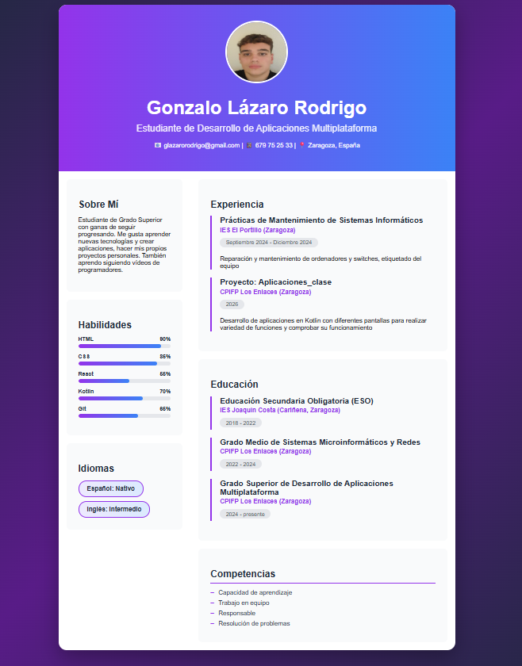

# Curriculum Vitae en React

Currículum vitae creado con React y Vite para el módulo de Desarrollo de Interfaces.

## Herramientas utilizadas
- Visual Studio Code (extensiones: JavaScript (ES6) Code Snippets y Live Server)
- Node.js y npm
- Vite + React
- Git y GitHub
- Consola del navegador (F12) para comprobar que no hay errores

## Estructura
- `src/App.jsx`: Componente `App`. Los datos del CV están en constantes (arrays) y se recorren con `map()`.
- `src/App.css`: Estilos (degradados, bordes redondeados, sombras, CSS Grid de dos columnas y diseño adaptable).
- `public/`: Imagen de perfil.

## Cómo ejecutarlo
    npm install
    npm run dev

Abrir http://localhost:5173/

## Versión de producción
    npm run build
La carpeta `dist` contiene la aplicación lista para publicar.
